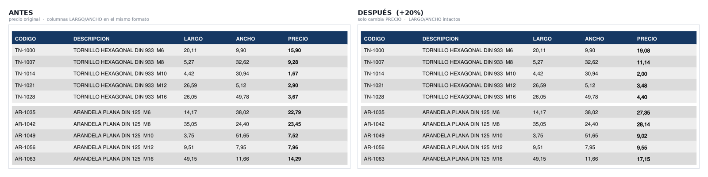

# Actualizar precios en un catálogo PDF, sin rehacer el catálogo

Un distribuidor recibe la lista de precios de su proveedor en PDF y necesita
revenderla con su propio margen: los mismos productos, el mismo diseño, todos
los precios un porcentaje más arriba y sin la marca del proveedor.

Este repositorio resuelve eso y, sobre todo, **verifica que el resultado sea
correcto** sin tener que revisar el PDF página por página.



---

## Por qué no es un buscar-y-reemplazar

Los tres problemas que hacen fallar la solución obvia no se ven hasta que
el archivo ya está entregado.

### 1. No todo número con formato `X,XX` es un precio

En una tabla de suministro industrial las columnas de medida usan exactamente
el mismo formato que el precio:

| CÓDIGO | DESCRIPCIÓN | LARGO | ANCHO | PRECIO |
|---|---|---|---|---|
| TN-1000 | TORNILLO HEXAGONAL DIN 933 M6 | 20,11 | 9,90 | **15,90** |

Un `re.sub(r'\d+,\d{2}', ...)` sobre el texto de la página sube el precio
**y también el largo y el ancho**. El PDF sigue pareciendo perfecto. El error
aparece cuando un cliente pide un tornillo de 24 mm y recibe uno de 20.

**Solución:** agrupar las palabras de la página en líneas por su coordenada Y
y, en cada línea, recorrer **de derecha a izquierda** quedándose con el primer
número que coincida. En una tabla de precios la columna de precio es la última
de la fila, así que el primero por la derecha es el precio y las medidas
quedan intactas.

En la demo, las páginas de tabla tienen 30 números con formato de precio y
solo 10 son precios. El script cambia 10 y deja 20 sin tocar.

### 2. Tapar un texto con un rectángulo no lo elimina

La forma natural de reemplazar un precio es dibujar un rectángulo del color
del fondo encima y escribir el valor nuevo. Visualmente queda perfecto.

Pero el texto original **sigue en la capa de texto del PDF**:

```bash
pdftotext catalogo_ACTUALIZADO.pdf -   # devuelve los precios viejos
```

Cualquiera que seleccione y copie, o que pase el archivo por un extractor,
recupera la lista de precios del proveedor y el margen aplicado. Para un
catálogo que se manda a clientes, eso es una fuga de datos.

**Solución:** `add_redact_annot()` + `apply_redactions()`, que eliminan el
texto del archivo, y recién después escribir el valor nuevo. Lo mismo para el
texto de la banda de marca del encabezado: no se tapa, se borra.

El alcance es la **capa de texto**. El rectángulo de color de la banda es un
gráfico vectorial y queda en el archivo debajo del parche blanco; las imágenes
no se tocan. Si la marca del proveedor fuera un logo en imagen, seguiría
dentro del PDF.

### 3. `search_for()` busca subcadenas

En las páginas con varios precios por línea no sirve la regla de
derecha-a-izquierda, así que hay que localizar cada precio por su texto. El
camino evidente es `page.search_for("9,87")` — pero eso **también encuentra el
`9,87` que está dentro de `19,87`**, redacta ese trozo y escribe encima. La
celda queda corrompida y el resultado sigue pareciendo un precio válido.

En la demo son 5 colisiones de 88 precios. Se resuelve comparando palabras
completas (`get_text("words")` + regex anclado) en vez de buscar subcadenas.

Este lo encontró la verificación automática, no la revisión visual.

---

## Verificación

`validar.py` no importa nada de `actualizar_precios.py`: compara los dos PDF
palabra por palabra. Cada número con formato `X,XX` del original se busca en
la misma posición del PDF nuevo, donde tiene que seguir igual o haber quedado
multiplicado. Sobre eso hace cinco comprobaciones:

| Comprobación | Qué detecta |
|---|---|
| El último número de cada línea de tabla (todos, en páginas multicolumna) | que el precio sea exactamente el viejo × multiplicador, y que no se haya salteado ninguno |
| El resto de los números de cada línea de tabla | que las medidas sigan intactas |
| Líneas que alternan código y precio en una página de tabla | una página multicolumna que no se pasó por `--multicolumna` |
| Cantidad de números por página, antes y después | que no se haya escrito un precio encima de otro texto, ni perdido un número |
| Cadenas de marca en la capa de texto | que el texto de la marca esté eliminado, no tapado |

El conteo por página es la comprobación más barata: si una página tenía 88
números con formato de precio y la salida tiene 93, algo se escribió donde no
debía, aunque el PDF se vea bien. Así apareció la colisión de subcadenas.

Salida completa de los comandos de [Correrlo](#correrlo):

```
Paginas: 4

--- PRECIOS ---
  esperados                   : 108
  correctos (+20% exacto)     : 108  (100.00%)
  salteados (siguen iguales)  : 0
  con otro valor              : 0
  sin texto en su posicion    : 0

--- MEDIDAS Y OTROS NUMEROS (paginas de tabla) ---
  numeros que no son precio   : 40
  modificados                 : 0

--- LINEAS DE TABLA QUE PARECEN MULTICOLUMNA ---
  lineas sospechosas          : 0

--- FUGA DE DATOS EN LA CAPA DE TEXTO ---
  (revisadas 3 paginas; 1 conservan el encabezado a proposito)
  'NORVAL': ausente (ok)
  'SUMINISTROS': ausente (ok)
  'LISTA DE PRECIOS': ausente (ok)

--- CANTIDAD DE NUMEROS POR PAGINA (antes -> despues) ---
  pag   1:    0 ->    0   (0 precios)
  pag   2:   30 ->   30   (10 precios)
  pag   3:   30 ->   30   (10 precios)
  pag   4:   88 ->   88   (88 precios)

RESULTADO: TODO OK
```

### Que el validador falle cuando tiene que fallar

`pruebas/test_sabotajes.py` rompe el proceso a propósito y comprueba que la
validación lo detecta:

- **Sin la regla derecha-a-izquierda**, las medidas se actualizan como si
  fueran precios → `medida 20,11 tratada como precio -> 24,13`.
- **Sin `--multicolumna`**, se actualiza solo el último precio de cada línea
  de la página 4 y se saltean 66 de 88 → `linea con codigos entre precios
  (JT-201...): pagina multicolumna sin --multicolumna?`

En los dos casos el PDF se ve bien y el resultado es `HAY QUE REVISAR`.

**Limitación, dicha de frente:** el validador no comparte código con el
script, pero sí un supuesto: en una página de tabla, el precio es el último
número con formato `X,XX` de la línea. Si un catálogo no lo cumple (ver
[Limitaciones conocidas](#limitaciones-conocidas)), el script y el validador
se equivocan igual. Y la detección de multicolumna sin marcar es
una heurística: busca una palabra con dígitos (un código) entre dos precios
de la misma línea.

---

## Correrlo

```bash
pip install pymupdf

python generar_catalogo_demo.py          # crea el catálogo sintético

python actualizar_precios.py \
    demo/catalogo_ORIGINAL.pdf demo/catalogo_ACTUALIZADO.pdf \
    -p 20 --multicolumna 3 --conservar-encabezado 0

python validar.py \
    demo/catalogo_ORIGINAL.pdf demo/catalogo_ACTUALIZADO.pdf \
    -p 20 --multicolumna 3 --conservar-encabezado 0 \
    --marcas NORVAL SUMINISTROS "LISTA DE PRECIOS"

python pruebas/test_sabotajes.py         # comprueba que el validador detecta errores
```

| Opción | Para qué |
|---|---|
| `-p 20` | porcentaje de aumento |
| `--multicolumna 3` | páginas (base 0) con varios precios por línea |
| `--conservar-encabezado 0` | páginas donde **no** borrar la banda de marca |
| `--dejar-encabezado` | no borrar la marca en ninguna página |

---

## Limitaciones conocidas

Estos casos fallan **en silencio**: el script termina sin error y, salvo
donde se indica, el validador da `TODO OK`.

- **Precios con otro formato que `X,XX`.** El patrón solo reconoce números
  como `15,90`. Con `1.234,56` (separador de miles), `15,90€` (símbolo
  pegado) o una fila sin precio, la regla derecha-a-izquierda toma como
  precio el último número que sí reconoce, que es una medida. En la fila
  `12,50 … 1.234,56` el script sube `12,50` a `15,00` y deja el precio como
  estaba. El validador comparte el supuesto y tampoco lo detecta.
  (`15,90 €`, con espacio, funciona: el `€` es otra palabra).
- **Encabezado fijo de 91 pt.** `Y_LIMITE_ENCABEZADO = 91.0` está ajustado a
  la demo. En cada página que no está en `--conservar-encabezado` se borra
  todo lo que haya por encima, precios incluidos, sin aviso. El validador lo
  muestra en el conteo por página (`eliminados con el encabezado`) pero no lo
  cuenta como error.
- **Índices de página en base 0, salida en base 1.** `--multicolumna 3` es
  la página que el script imprime como `pagina 4`. Usar el número de la
  salida marca la página equivocada. Si una página multicolumna queda sin
  marcar, el validador lo detecta; si una página de **tabla** queda marcada
  como multicolumna, el script sube también las medidas y el validador no lo
  ve, porque en esas páginas espera que todos los números cambien.

Además:

- El precio nuevo se escribe siempre en Helvetica 8 pt negra (con trazo para
  simular negrita), sea cual sea la fuente original.
- De la banda de marca se elimina el texto; el fondo vectorial y las
  imágenes quedan en el archivo.
- Los metadatos del PDF de entrada (autor, título) pasan sin cambios a la
  salida.

---

## Escala real

El caso que originó esto fue un catálogo de **más de 70 páginas y más de mil
precios**. El script lo procesa en segundos; hacerlo a mano en un editor de
PDF son varias horas de trabajo repetitivo, y cada corrección manual es una
oportunidad más de equivocarse en un número que después nadie revisa.

Más importante que el tiempo: la verificación automática encontró dos errores
—la fuga en la capa de texto y la colisión de subcadenas— que una revisión
visual no detecta, porque en los dos casos **el PDF se ve bien**.

---

## Archivos

| Archivo | Qué hace |
|---|---|
| `generar_catalogo_demo.py` | genera el catálogo sintético de prueba |
| `actualizar_precios.py` | detecta y reemplaza los precios, borra la marca |
| `validar.py` | verifica la salida contra el original, sin compartir código con el script |
| `pruebas/test_sabotajes.py` | rompe el proceso a propósito y comprueba que la validación falla |
| `demo/` | catálogo sintético, antes y después |

Stack: Python 3 y [PyMuPDF](https://pymupdf.readthedocs.io/). Sin
dependencias externas más allá de eso.

---

## Confidencialidad

El catálogo de este repositorio es **sintético**: la empresa, los códigos y
los precios son inventados y se generan con `generar_catalogo_demo.py`. Está
construido con la misma estructura que un catálogo comercial real —incluidas
las columnas de medida en formato de precio, que son la trampa— para poder
demostrar y verificar el funcionamiento sin publicar material de ningún
cliente.
